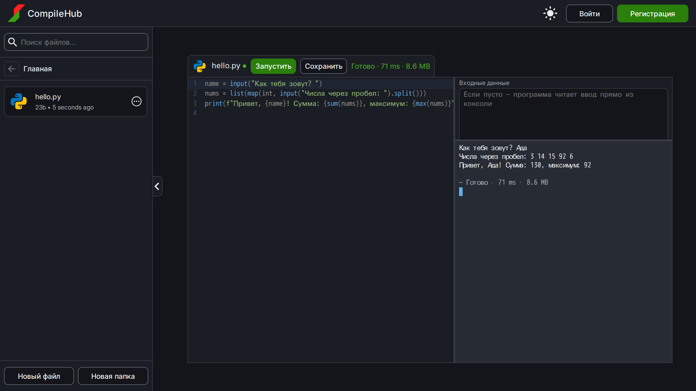
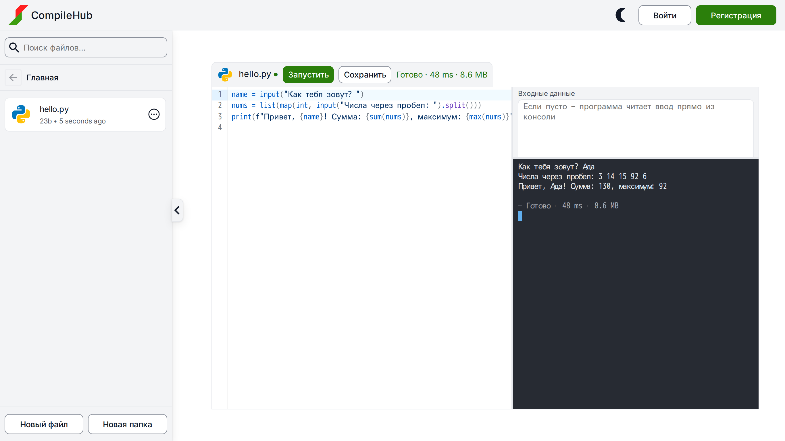
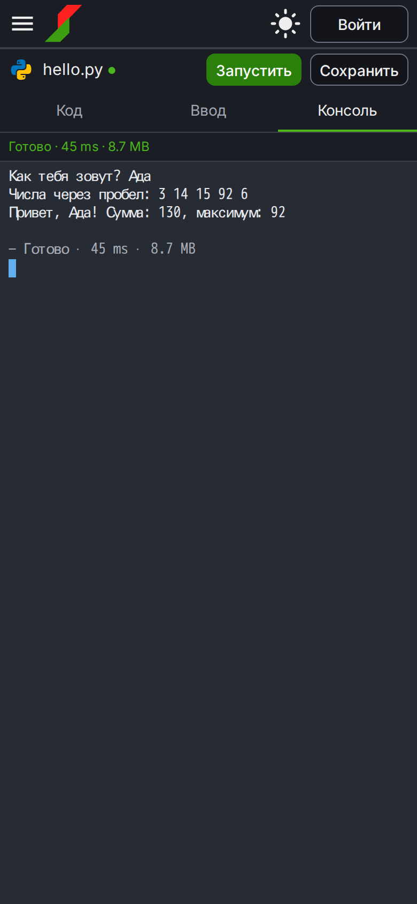

# CompileHub

[Русский](README.md) · **English**

[](https://github.com/EDeev/compile-hub/actions/workflows/ci.yml)
[](https://github.com/EDeev/compile-hub/actions/workflows/docker.yml)
[](LICENSE)

An online compiler: write code in the browser, run it in an isolated sandbox and type the program's input right in the console.

**Status:** team project, active (2026) · live at [compilehub.ru](https://compilehub.ru)



**Stack:** Python 3.12 · FastAPI · PostgreSQL · Redis Streams · nsjail · React · TypeScript · Vite · CodeMirror · xterm.js · Docker

## Features

- Six languages, latest versions: C++ (GCC 16, C++23), C (C23), Python 3.14, JavaScript (Node.js 26), Go 1.27, Java 27
- Interactive console: the program reads input while it runs and output streams back; or an "Input" field for a regular run
- Run result with a verdict (done, compilation error, time, memory or output limit), CPU time and peak memory
- Files and folders in an account; guest mode without signing up keeps files in the browser and moves them to the account after login
- Sign-up with email confirmation, password reset, sign-in with Yandex ID and VK ID
- Mobile layout, light and dark themes, Russian and English UI; accessibility per WCAG 2.1 AA

## How it works

```
Browser ──HTTPS──▶ web (nginx: static + /api) ──▶ api (FastAPI, stateless)
                                                      │        │
                                             PostgreSQL        Redis Streams ◀──▶ worker × N
                                      (accounts, files,   (queue, output stream,   (nsjail: compile
                                       run history)        input, rate limits)       and run)
```

- **api** queues a job in Redis and streams run events over WebSocket; console input goes back over the same
  connection. Workers put results into a separate stream, and api writes them to PostgreSQL.
- **worker** takes jobs through a consumer group, compiles (artifacts are cached by code hash) and runs the program in
  [nsjail](https://github.com/google/nsjail): its own namespaces (no network, uid 65534), a read-only root, seccomp,
  a separate cgroup v2 per run (memory without swap, process count, one core) and a tmpfs for working files. Memory and
  CPU time are measured for the program itself. On start the worker checks every language with "Hello, world" and
  doesn't announce one that fails; it pauses when the CPU overheats.
- **web** is a React app; the editor and console load once a file is opened.

Default limits: a regular run gets 3 s of CPU and 10 s of wall time, an interactive one 5 s of CPU, 60 s of wall time and
30 s without input; program memory is 256 MB, output 64 KB. API reference: [compilehub.ru/api/docs](https://compilehub.ru/api/docs).

## Quick start

You need Linux with cgroup v2, Docker with Compose and PostgreSQL 14+.

```bash
git clone https://github.com/EDeev/compile-hub.git && cd compile-hub/deploy
cp env.example .env                 # fill in: database, JWT secret, SMTP, Redis passwords
cp users.acl.example users.acl      # put in the same Redis passwords
docker compose up -d
```

The site listens on `127.0.0.1:8096`; put a TLS reverse proxy in front of it. Images: `ghcr.io/edeev/compile-hub-api`,
`compile-hub-worker`, `compile-hub-web`; with `REGISTRY=docker.io/library/` in `.env` locally built ones are used
(`docker build -f worker/Dockerfile -t compile-hub-worker .`, and the same for `api/` and `frontend/`).

> [!IMPORTANT]
> The worker needs `--privileged` and `--cgroupns=private`: nsjail creates namespaces and the worker creates a cgroup per
> run. The sandbox won't start without them. The worker holds no secrets other than its own Redis password: it has no
> database access, and the Redis ACL only opens the queue keys to it.

## Configuration

| Variable | What it sets |
|---|---|
| `CH_DATABASE_URL` | PostgreSQL, `postgresql+asyncpg://…`; migrations run when api starts |
| `CH_REDIS_URL` | Redis for api (compose builds it from `REDIS_API_PASSWORD`) |
| `CH_JWT_SECRET` | token signing secret, required with `CH_ENV=prod` |
| `CH_PUBLIC_URL` | site address, for links in emails and returns from sign-in services |
| `CH_SMTP_HOST`, `CH_SMTP_PORT`, `CH_SMTP_USER`, `CH_SMTP_PASSWORD`, `CH_MAIL_FROM` | sending email; without `CH_SMTP_HOST` emails only go to the log |
| `CH_YANDEX_CLIENT_ID`, `CH_YANDEX_CLIENT_SECRET` | sign-in with Yandex ID; empty means no button |
| `CH_VK_CLIENT_ID`, `CH_VK_CLIENT_SECRET` | sign-in with VK ID; empty means no button |
| `CH_QUEUE_MAX` | how many jobs may wait in the queue (30 by default) |
| `WORKER_SLOTS` | concurrent runs per worker (1 by default) |
| `WORKER_LANGUAGES` | enabled languages: `cpp,c,python,javascript,go,java` |
| `WORKER_PAUSE_AT`, `WORKER_RESUME_AT` | thermal protection: pause and resume by CPU temperature, °C (75 and 68) |

## Deployment

At [compilehub.ru](https://compilehub.ru) the project runs from `deploy/docker-compose.yml` on a single server:
PostgreSQL on the host, TLS on an external nginx, one worker slot limited to one core. api (`/metrics`) and the worker
(port 9200) expose Prometheus metrics; alert rules are in `deploy/prometheus/compilehub-rules.yml`. A new language is an
entry in the `protocol/` registry plus a toolchain in `worker/Dockerfile`; the core stays the same.

## Development

```bash
uv sync --all-packages                                  # api, worker and the shared protocol
TEST_DATABASE_URL=postgresql+asyncpg://… TEST_REDIS_URL=redis://… uv run pytest -q
uv run ruff check . && uv run ruff format --check .

docker build -f worker/Dockerfile --target test -t worker-test .    # the sandbox runs in a privileged container
docker run --rm --privileged --cgroupns=private -e WORKER_REDIS_URL=redis://… worker-test

cd frontend && npm ci && npm run dev                    # /api is proxied to localhost:8000
```

CI on GitHub Actions: ruff and api tests against PostgreSQL and Redis, 27 sandbox tests (all languages, limits, escape
attempts: fork bomb, network, file system, dangerous system calls), frontend lint and build. Images are published to
GHCR on `v*` tags.

<table>
  <tr>
    <td></td>
    <td width="24%"></td>
  </tr>
</table>

## License

MIT — see [LICENSE](LICENSE).

## Authors

- **Egor Deev** — [GitHub](https://github.com/EDeev) — backend, sandbox, frontend, deployment
- **Petr Saprykin** — [GitHub](https://github.com/PetrSaprykin) — design and the original frontend

---

<div align="center">
  <sub>⭐ If you find this project useful, give it a star on GitHub!</sub>
  <p><sub>Made with ❤️ by the CompileHub team</sub></p>
</div>
