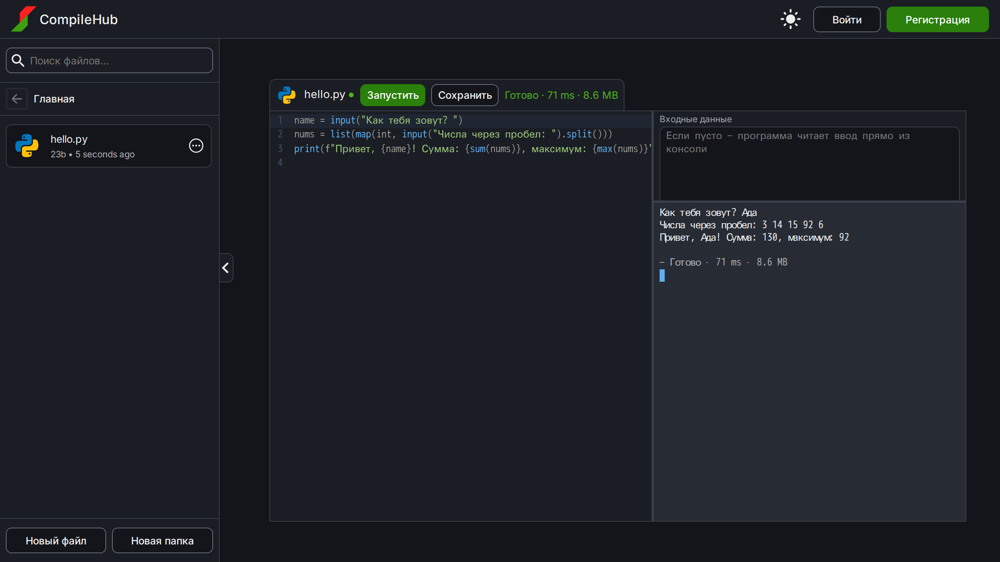
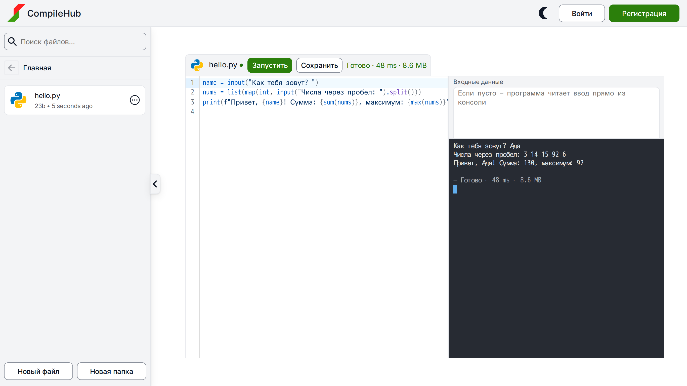
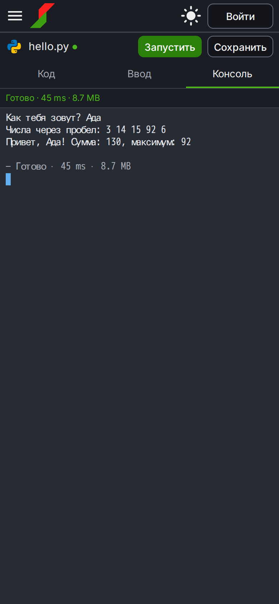

# CompileHub

**Русский** · [English](README.en.md)

[](https://github.com/EDeev/compile-hub/actions/workflows/ci.yml)
[](https://github.com/EDeev/compile-hub/actions/workflows/docker.yml)
[](LICENSE)

Онлайн-компилятор: код пишется в браузере, выполняется в изолированной песочнице, а ввод для программы набирается прямо в консоли.

**Статус:** командный проект, активен (2026) · работает на [compilehub.ru](https://compilehub.ru)



**Стек:** Python 3.12 · FastAPI · PostgreSQL · Redis Streams · nsjail · React · TypeScript · Vite · CodeMirror · xterm.js · Docker

## Возможности

- Шесть языков последних версий: C++ (GCC 16, C++23), C (C23), Python 3.14, JavaScript (Node.js 26), Go 1.27, Java 27
- Интерактивная консоль: программа читает ввод по ходу выполнения, вывод приходит потоком; или поле «Входные данные» для обычного запуска
- Итог запуска с вердиктом (готово, ошибка компиляции, превышено время, память, объём вывода), CPU-временем и пиковой памятью
- Файлы и папки в аккаунте; гостевой режим без регистрации — файлы в браузере, переносятся в аккаунт после входа
- Регистрация с подтверждением почты, сброс пароля, вход через Яндекс ID и VK ID
- Мобильная версия, светлая и тёмная темы, интерфейс на русском и английском; доступность по WCAG 2.1 AA

## Как устроено

```
Браузер ──HTTPS──▶ web (nginx: статика + /api) ──▶ api (FastAPI, без состояния)
                                                       │        │
                                              PostgreSQL        Redis Streams ◀──▶ worker × N
                                       (аккаунты, файлы,   (очередь, поток вывода,   (nsjail: компиляция
                                        история запусков)   ввод, лимиты частоты)     и запуск)
```

- **api** ставит задачу в очередь Redis и отдаёт события запуска по WebSocket; ввод из консоли идёт обратно тем же
  соединением. Итоги воркеры кладут в отдельный стрим, api записывает их в PostgreSQL.
- **worker** берёт задачи через consumer group, компилирует (артефакты кэшируются по хешу кода) и запускает программу
  в [nsjail](https://github.com/google/nsjail): свои namespaces (без сети, uid 65534), корень только для чтения, seccomp,
  отдельная cgroup v2 на каждый запуск (память без swap, процессы, одно ядро) и tmpfs для рабочих файлов. Память
  и CPU-время меряются у самой программы. При старте воркер проверяет каждый язык на «Hello, world» и не объявляет тот,
  что не прошёл; при перегреве CPU берёт паузу.
- **web** — React-приложение; редактор и консоль подгружаются, когда открыт файл.

Лимиты по умолчанию: обычный запуск — 3 с CPU и 10 с стены, интерактивный — 5 с CPU, 60 с стены и 30 с без ввода;
память программы — 256 МБ, вывод — 64 КБ. Описание API — [compilehub.ru/api/docs](https://compilehub.ru/api/docs).

## Быстрый старт

Нужны Linux с cgroup v2, Docker с Compose и PostgreSQL 14+.

```bash
git clone https://github.com/EDeev/compile-hub.git && cd compile-hub/deploy
cp env.example .env                 # заполнить: база, JWT-секрет, SMTP, пароли Redis
cp users.acl.example users.acl      # подставить те же пароли Redis
docker compose up -d
```

Сайт — на `127.0.0.1:8096`, перед ним ставится обратный прокси с TLS. Образы — `ghcr.io/edeev/compile-hub-api`,
`compile-hub-worker`, `compile-hub-web`; с `REGISTRY=docker.io/library/` в `.env` используются собранные локально
(`docker build -f worker/Dockerfile -t compile-hub-worker .` и так же для `api/` и `frontend/`).

> [!IMPORTANT]
> Воркеру нужны `--privileged` и `--cgroupns=private`: nsjail создаёт namespaces, а воркер — cgroup на каждый запуск.
> Без этого песочница не запустится. Секретов, кроме пароля своего пользователя Redis, у воркера нет: доступа к базе
> у него нет, а в Redis ACL открывает ему только ключи очереди.

## Конфигурация

| Переменная | Что задаёт |
|---|---|
| `CH_DATABASE_URL` | PostgreSQL, `postgresql+asyncpg://…`; миграции применяются при старте api |
| `CH_REDIS_URL` | Redis для api (в compose собирается из `REDIS_API_PASSWORD`) |
| `CH_JWT_SECRET` | секрет подписи токенов, обязателен в `CH_ENV=prod` |
| `CH_PUBLIC_URL` | адрес сайта — для ссылок в письмах и возврата со входа через сервисы |
| `CH_SMTP_HOST`, `CH_SMTP_PORT`, `CH_SMTP_USER`, `CH_SMTP_PASSWORD`, `CH_MAIL_FROM` | отправка писем; без `CH_SMTP_HOST` письма только пишутся в лог |
| `CH_YANDEX_CLIENT_ID`, `CH_YANDEX_CLIENT_SECRET` | вход через Яндекс ID; пусто — кнопки нет |
| `CH_VK_CLIENT_ID`, `CH_VK_CLIENT_SECRET` | вход через VK ID; пусто — кнопки нет |
| `CH_QUEUE_MAX` | сколько задач может стоять в очереди (по умолчанию 30) |
| `WORKER_SLOTS` | одновременных запусков на воркер (по умолчанию 1) |
| `WORKER_LANGUAGES` | включённые языки: `cpp,c,python,javascript,go,java` |
| `WORKER_PAUSE_AT`, `WORKER_RESUME_AT` | термозащита: пауза и продолжение по температуре CPU, °C (75 и 68) |

## Развёртывание

На [compilehub.ru](https://compilehub.ru) проект работает через `deploy/docker-compose.yml` на одном сервере:
PostgreSQL на хосте, TLS — на внешнем nginx, воркер с одним слотом и ограничением в одно ядро. Метрики Prometheus
отдают api (`/metrics`) и воркер (порт 9200); правила алертов — `deploy/prometheus/compilehub-rules.yml`.
Новый язык — запись в реестре `protocol/` и тулчейн в `worker/Dockerfile`, ядро не меняется.

## Разработка

```bash
uv sync --all-packages                                  # api, worker и общий protocol
TEST_DATABASE_URL=postgresql+asyncpg://… TEST_REDIS_URL=redis://… uv run pytest -q
uv run ruff check . && uv run ruff format --check .

docker build -f worker/Dockerfile --target test -t worker-test .    # песочница — в привилегированном контейнере
docker run --rm --privileged --cgroupns=private -e WORKER_REDIS_URL=redis://… worker-test

cd frontend && npm ci && npm run dev                    # /api проксируется на localhost:8000
```

CI в GitHub Actions: ruff и тесты api на PostgreSQL и Redis, 27 тестов песочницы (все языки, лимиты, попытки выйти из
песочницы: fork-бомба, сеть, файловая система, опасные системные вызовы), линтер и сборка фронтенда. Образы публикуются
в GHCR по тегам `v*`.

<table>
  <tr>
    <td></td>
    <td width="24%"></td>
  </tr>
</table>

## Лицензия

MIT — см. [LICENSE](LICENSE).

## Авторы

- **Егор Деев** — [GitHub](https://github.com/EDeev) — бэкенд, песочница, фронтенд, развёртывание
- **Пётр Сапрыкин** — [GitHub](https://github.com/PetrSaprykin) — дизайн и исходный фронтенд

---

<div align="center">
  <sub>⭐ Если проект оказался полезным, поставьте звёздочку на GitHub!</sub>
  <p><sub>Сделано с ❤️ командой «CompileHub»</sub></p>
</div>
